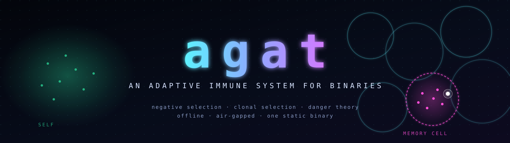
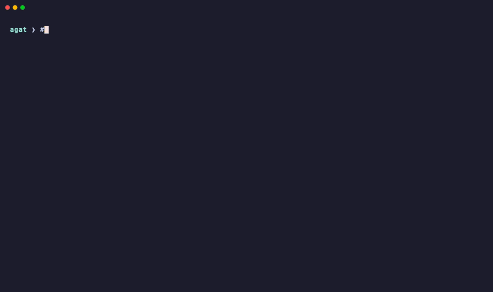
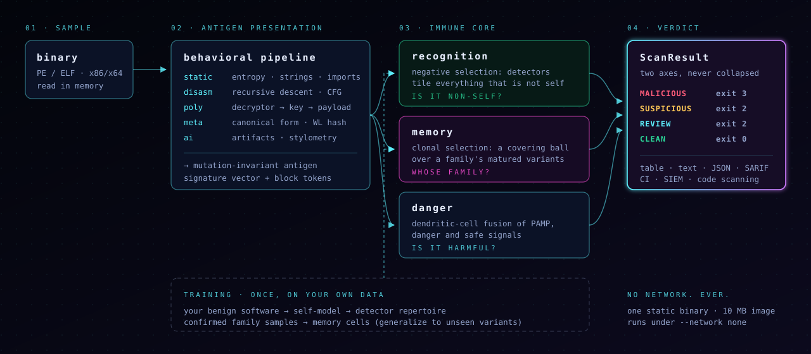

<p align="center">
  
</p>

<p align="center">
  <b>Malware learned to rewrite itself. agat learns back.</b><br>
  An offline, air-gapped <b>artificial immune system</b> that catches polymorphic,
  metamorphic, and AI-rewritten variants by <i>what they are</i>, not by what they look like.
</p>

<p align="center">
  <a href="LICENSE"></a>
  
  
  
  
  
</p>

<p align="center">
  <a href="#-see-it-in-60-seconds">Demo</a> ·
  <a href="#-how-it-works">How it works</a> ·
  <a href="#-measured-not-promised">Benchmarks</a> ·
  <a href="#-deploy-it">Deploy</a> ·
  <a href="docs/READING_OUTPUT.md">Reading the output</a> ·
  <a href="docs/ARCHITECTURE.md">Architecture</a>
</p>

---

## The surface is no longer a signal

Every generation of malware has attacked the same assumption: that a threat
looks the same twice.

| generation | what mutates | what breaks |
|---|---|---|
| **Polymorphic** | the encryption wrapping the body: a new key and a new stub every copy | file hashes, byte signatures |
| **Metamorphic** | the code itself: registers swapped, junk inserted, instructions re-encoded | stub signatures, naive disassembly matching |
| **AI-rewritten** | the *algorithm*: an LLM re-implements the same behavior in different code, on demand, at scale | everything keyed to structure, including canonical-form hashing |

Signature engines, YARA rules, and fuzzy hashes all match the **surface**,
and the surface is now free to change. An attacker with a code model can mint
a thousand behaviorally identical variants before lunch. Each one is "new" to a
signature, and each one costs an analyst time.

Your body has been fighting that exact problem for 500 million years.

## agat doesn't match. It *recognizes*.

A pathogen mutates its surface proteins constantly, and the immune system still
catches it. It doesn't keep a list of known viruses. It learns **what "self" is**,
grows detectors for **everything that isn't**, and when it meets a pathogen,
it forms **memory** that recognizes the pathogen's *relatives*, including ones it
has never encountered.

agat runs that logic on binaries:

- 🧬 **Antigen presentation.** Every sample is distilled into a
  *mutation-invariant behavioral antigen*: canonicalized control flow, opcode
  shape, the decrypted payload's fingerprint, and the semantic tells of LLM
  rewriting. These are the properties that survive the rewrites.
- 🛡️ **Negative selection.** From *your* benign software, agat models "self" and
  generates a repertoire of detectors that tile everything outside it. Anything
  that lands outside self gets bound, with no malware needed to train this layer.
- 🧠 **Clonal selection and immune memory.** Feed it a few confirmed variants of a
  family and it matures a **memory cell**: a region of behavior space covering the
  family's neighborhood. The next variant, which no hash has ever seen, triggers a
  *secondary response*: `family metamorph · affinity 0.92`.
- ⚠️ **Danger theory.** *Different* is not *dangerous*. A dendritic-cell-style
  layer fuses concrete harm signals (a recovered decryptor key, packed regions,
  W+X sections, embedded LLM artifacts) so unusual-but-benign software isn't
  dragged into an alert.

> Two independent questions, **"is it foreign?"** and **"is it harmful?"**, are
> answered separately and fused only at the end. When they agree, you get
> **MALICIOUS**. When they don't, agat tells you which axis fired so a human can
> decide.

## ⚡ See it in 60 seconds

<p align="center">
  
</p>

That run is real: a metamorphic variant agat was **never trained on** is attributed
to its family by a memory cell; an **AI-rewritten** variant (same payload, swapped
decryption algorithm) is caught as a dangerous anomaly; a baseline file comes back
clean; then the batch goes out as SARIF with a failing exit code.

Reproduce it yourself:

```bash
git clone https://github.com/Armur-Ai/agat && cd agat
cargo build --release -p agat-cli
demo/run.sh                     # train + all four acts, deterministic, offline
```

And the air-gap proof: build the container, then replay the same demo under
`docker run --network none` and diff the two transcripts:

```bash
docker build -t agat .
demo/run.sh --compare agat      # → IDENTICAL: laptop and --network none produced the same transcript
```

## 🔬 How it works

<p align="center">
  
</p>

| immune mechanism | algorithm | in agat |
|---|---|---|
| **Antigen presentation** | behavioral feature projection | five analyzers → one signature vector + canonical block tokens (`agat-antigen`) |
| **Self / non-self** | variable-radius self region | the benign region of signature space, learned from *your* software (`agat-immune::self_model`) |
| **Negative selection** | NSA, Forrest et al. 1994; V-detector, Ji & Dasgupta 2004 | detectors generated at random, **censored** if they touch self, kept if they cover non-self |
| **Clonal selection** | CLONALG, de Castro & Von Zuben 2002 | clone ∝ affinity, hypermutate ∝ 1/affinity, promote the best to **memory cells** |
| **Danger theory** | Dendritic Cell Algorithm, Greensmith & Aickelin 2005 | PAMP / danger / safe signal fusion into a context: `safe` · `ambiguous` · `dangerous` |

Under the immune core sits a full binary-analysis pipeline, written from scratch
in Rust:

- **Static** (`agat-static`): PE/ELF parsing, sliding-window entropy, string
  extraction, imports/exports, SHA-256 / MD5 / imphash.
- **Disassembly** (`agat-disasm`): x86/x64 recursive descent with CFG construction.
- **Polymorphic** (`agat-poly`): finds the decryptor loop, **recovers the key**,
  decrypts the payload, and fingerprints the *plaintext*. Two samples carrying the
  same payload under different encryption share that fingerprint.
- **Metamorphic** (`agat-meta`): canonical form (register slots, NOP removal,
  immediates collapsed) and **Weisfeiler–Lehman hashing** of the CFG, so register-
  swapped, junk-padded variants converge to one fingerprint.
- **AI signals** (`agat-ai`): LLM artifacts (refusal strings, ChatML markers,
  tokenizer fragments, model magic), stylometry, and **cross-variant divergence**:
  the *same decrypted payload behind a different control-flow graph*, which is the
  algorithm-substitution signature of an LLM rewrite. Classical metamorphic
  engines don't produce it.

**About the "model".** agat has no neural network and needs no GPU or download.
What it learns is a set of geometric immune structures (the self region, the
detector repertoire, the memory cells) fitted to *your* samples by the
algorithms above, and stored locally. Training on a few hundred binaries takes
seconds on a laptop. (The AI-signal layer can optionally consult a local GGUF
code model through `llama.cpp` for perplexity; by default it uses a built-in
approximation.)

## 📊 Measured, not promised

Every number below is reproducible with one command from [`bench/`](bench/README.md),
offline.

| claim | benchmark | result |
|---|---|---|
| recognizes variants it has **never seen** | `bench/run.sh`: train on 8 metamorphic variants, test 8 held-out ones | **8 / 8 detected**, all attributed to the family |
| doesn't flag normal software | same run: **110 held-out real Debian x86-64 binaries** | **0 / 110 false positives** |
| a single held-out sibling, end to end | `bench/generalize.sh` | recognized, affinity **0.92**, via memory cell |
| not a hand-tuned knife edge | `bench/sweep.sh`: retrain under 32 perturbed weightings (each weight ×0.5–×2) | detection **100%** and FPs **0%** in every one |
| truly air-gapped | `demo/run.sh --compare` under `docker run --network none` | **byte-identical** transcript |

The honest fine print, which `bench/README.md` spells out in full: the variant
family is **synthetic** (generated by `tools/*_gen.py`), 0/110 bounds the true
false-positive rate below ~2.7% at 95% confidence rather than proving zero, and
the self-model must be trained on benign software like the software you scan.
We publish the weaknesses the benchmarks found, too.

## 🚀 Deploy it

**One binary. One container. No network. Ever.** No cloud lookups, no telemetry,
no model to fetch. It works in a SCIF, on an OT network, or on a laptop on a plane.

```bash
# container (~10 MB, scratch base)
docker run --rm --network none \
  -v "$HOME/.agat:/data" -v "$PWD:/scan:ro" agat scan /scan --output table

# from source
cargo install --locked --path crates/agat-cli
```

### Train it on your environment (once)

```bash
export AGAT_VAULT_PASSWORD=…              # samples are kept AES-256-GCM encrypted at rest
agat ingest ./golden-image-binaries/* ./confirmed-family/*
agat analyze
agat self build <benign-ids…>             # learn "self" from your software
agat repertoire generate --seed 1         # negative selection
agat mature <id> --family qakbot          # teach it a family; repeat per variant
```

### Scan anything (stateless, no password, nothing written)

```bash
agat scan ./quarantine --output table               # one line per file
agat scan ./build/out --sarif > agat.sarif          # GitHub/GitLab code scanning, SIEMs
agat scan ./artifacts --json | jq '.[] | select(.verdict.severity=="malicious")'
agat scan ./release --fail-on malicious             # gate a pipeline on the verdict
```

Exit codes are the contract: **`0`** clean · **`2`** review/suspicious ·
**`3`** malicious · **`1`** agat itself failed.

### Drop it into CI

```yaml
# assumes the agat binary and your trained agat home (AGAT_HOME) on the runner
- name: agat variant scan
  run: agat scan dist/ --sarif --fail-on malicious > agat.sarif
- uses: github/codeql-action/upload-sarif@v3
  if: always()
  with: { sarif_file: agat.sarif }
```

### Tune it

`~/.agat/config.toml` (flags override it):

```toml
[scan]
output  = "table"        # text | table | json | sarif
fail_on = "suspicious"   # review | suspicious | malicious | never

[danger]
dangerous_at = 0.5       # how much harm evidence makes "dangerous"
safe_below   = 0.33

[allowlist]
sha256 = ["…"]           # your signed in-house tools: always clean
[denylist]
sha256 = ["…"]           # known-bad: always malicious (wins)
```

New to the output? **[How to read agat output](docs/READING_OUTPUT.md)** is the
one-page field guide.

## 🧩 Where agat fits in your stack

agat is a **variant-catching layer**, not an antivirus replacement.

| layer | catches | misses |
|---|---|---|
| signature AV / YARA | exact known threats, fast | anything re-encrypted, re-compiled or rewritten |
| EDR | malicious *runtime* behavior | threats that never execute on a monitored host; offline artifacts |
| **agat** | **new variants of known families**, foreign binaries carrying harm signals, pre-execution, offline | threats that look benign *and* carry no harm signals; architectures it doesn't analyze yet (below) |

Put it where binaries enter your world: build outputs, artifact registries,
quarantine folders, email-gateway detonation drops, golden images, air-gapped
transfer stations.

## 🧭 What agat is not (yet)

Defenders deserve exact limits, so here they are:

- **Coverage**: x86/x64 PE and ELF. Mach-O is detected but not parsed; ARM is not
  disassembled. Polymorphic key recovery handles single-byte XOR/ADD/SUB
  decryptors. Metamorphic normalization doesn't fold equivalent instruction
  sequences yet.
- **Static only**: no sandbox detonation (`agat-sandbox` is a reserved stub).
- **Your baseline matters**: "clean" means *indistinguishable from the self you
  trained*, not "proven safe".
- **Sharing a trained model** between machines currently means copying the agat
  home directory; signed, versioned repertoire packs are next on the roadmap.
- **Bio-inspired, not biology**: agat implements the *computational logic* of
  immune mechanisms. Where each analogy is strong or weak is documented in the
  [honesty ledger](docs/AIS_REBUILD_PLAN.md).

## 🗺️ Roadmap

- [x] Behavioral pipeline: static, disasm, poly, meta, AI signals
- [x] Immune core: self model, negative selection, clonal memory, danger theory
- [x] Operator CLI: stateless scan, table / JSON / SARIF, exit codes, config, allow/deny lists
- [x] Evidence: generalization, detection/FP rates on real binaries, weight sweep
- [x] Packaging: ~10 MB container, air-gap proof, deterministic demo
- [ ] Signed, exportable repertoire packs: train once, deploy to air-gapped fleets
- [ ] `agat serve`: local REST endpoint for SOAR / pipeline integration
- [ ] Coverage: multi-byte keys, Mach-O, ARM64, instruction folding
- [ ] `agat-rewriter`: ethically-scoped fixture generator for AI-rewrite research

Full plan: [`docs/PRODUCT_ROADMAP.md`](docs/PRODUCT_ROADMAP.md).

## 🏗️ Architecture

A Cargo workspace of small, independently testable crates:

```
agat-core      types, ScanResult contract, encrypted vault
agat-store     SQLite persistence: features, self-model, repertoire, memory
agat-static    PE/ELF parse · entropy · strings · imports   ┐
agat-disasm    x86/x64 recursive descent + CFG              │ antigen
agat-poly      decryptor → key → plaintext fingerprint      │ presentation
agat-meta      canonical form + Weisfeiler–Lehman hashing   │
agat-ai        LLM artifacts · stylometry · divergence      ┘
agat-antigen   signature vector + affinity metric
agat-immune    self model · negative selection · clonal memory · danger
agat-engine    analyze → recognize → fuse → ScanResult (+ SARIF)
agat-cli       the `agat` binary
agat-tui       terminal UI
```

Deep dive: [`docs/ARCHITECTURE.md`](docs/ARCHITECTURE.md).

## 📚 Citations

agat implements published algorithms:

- Forrest, Perelson, Allen & Cherukuri. *Self-Nonself Discrimination in a
  Computer.* IEEE S&P, 1994. Negative selection.
- Ji & Dasgupta. *Real-Valued Negative Selection Algorithm with Variable-Sized
  Detectors.* GECCO, 2004. The V-detector variant agat uses.
- de Castro & Von Zuben. *Learning and Optimization Using the Clonal Selection
  Principle.* IEEE Trans. Evol. Comput., 2002. CLONALG.
- Greensmith, Aickelin & Cayzer. *Introducing Dendritic Cells as a Novel
  Immune-Inspired Algorithm for Anomaly Detection.* ICARIS, 2005. The danger layer.

## 🤝 Ethics & responsible use

agat is a **defensive** tool for analysts, researchers, educators, and CTF authors.

- It analyzes binaries. It does not weaponize, exfiltrate, or help anything
  evade detection.
- Every fixture in this repository is **synthetic and benign**: decryptor stubs
  with demo strings, generated by `tools/*_gen.py`. Real samples are never
  redistributed.
- The planned `agat-rewriter` is scoped to benign or research-known payloads,
  solely as fixtures for agat to catch; it does not exist yet.
- Found a way to misuse agat? Please open an issue or contact the maintainers
  privately.

## License

[GNU AGPL v3](LICENSE). Anyone who runs a modified agat as a network service must
publish their changes. Improvements to a defensive commons should stay in the
commons.
