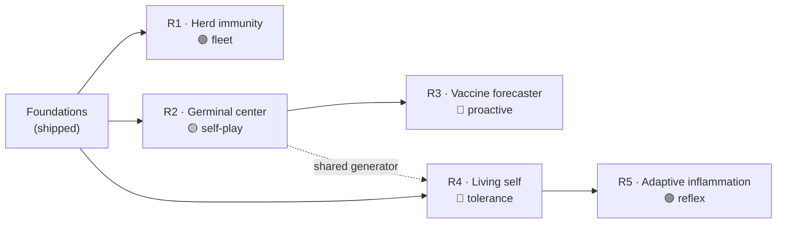

<!--
  ROADMAP.md — the forward horizon for agat's adaptive immune system.
  Companion: IMPLEMENTATION.md (granular build plans & task lists).
  Productization history (verdict object, CLI, packaging, eval) lives in
  docs/PRODUCT_ROADMAP.md and is largely shipped; this document is what comes
  next.
-->

# agat — Roadmap

> **Mission for this horizon:** take agat from a *static* immune system — one
> trained once and deployed — to an **adaptive, anti‑fragile** one that
> evolves against the threat, shares what it learns, keeps its model of "self"
> alive, and gets *sharper* under attack. The same way a biological immune
> system does.

This roadmap covers the five immune capabilities beyond today's engine. They
are **not shipped** — each phase below is a design direction with a concrete
build plan in **[`IMPLEMENTATION.md`](IMPLEMENTATION.md)**. The shipping
`agat` binary today does detection, training, signed packs, `serve`, and the
TUI; none of the phases here exist yet in code.

**Status legend:** 🟢 shippable soon (foundation exists) · 🟡 buildable (clear
path) · 🔵 research (open problems) · 🟣 frontier (vision; needs the layers
below it first).

---

## Foundations already shipped

Every phase here builds on the immune core that is **already in the tree** —
it is why the roadmap is engineering, not fantasy:

| Mechanism | Where it lives today |
|---|---|
| Antigen presentation (mutation‑invariant signature) | `agat-antigen` (`Antigen`, `ANTIGEN_LAYOUT_VERSION`) |
| Negative selection (self‑censored detectors) | `agat-immune::negative_selection::generate`, `NsaConfig` |
| Clonal selection (family maturation → memory) | `agat-immune::clonal::mature`, `memory::MemoryPool` |
| Danger theory (DCA signal fusion) | `agat-immune::danger::assess`, `signals_from_features`, `DangerConfig` |
| Self model (benign region, variable‑radius) | `agat-immune::self_model::SelfModel` |
| Signed model packs (train once, deploy air‑gapped) | `agat-engine::pack` (`build_payload`/`seal`/`verify`/`install`), `agat.pack/v1` |
| Synthetic variant generators (fixtures) | `tools/poly_gen.py`, `meta_gen.py`, `ai_gen.py` |
| Research rewriter / sandbox (stubs) | `agat-rewriter`, `agat-sandbox` crates |

## Invariants — carried through every phase

These are non‑negotiable and gate every PR on this roadmap:

1. **Offline & air‑gapped.** No network calls, ever. New capabilities ship
   learned artifacts (antibodies), never raw samples or telemetry.
2. **Deterministic.** Same inputs → bit‑identical outputs. Every stochastic
   step is seeded (`NsaConfig::seed`, `ClonalConfig::seed`, …).
3. **Defensive only.** Synthesis happens in **antigen/feature space** and with
   **inert, non‑executable** constructs. We sharpen the detector; we never
   produce a working weapon. The `agat-rewriter` guardrails (behavior‑
   preserving, AV‑gated, no persistence) are the model.
4. **0‑FP discipline.** Any new detection signal is validated at **zero false
   positives** on the benign corpora (`bench/`) before it merges.
5. **Explainable.** Every verdict decomposes into signals and affinities — no
   opaque scores.

---

## The five phases

| Phase | Theme | Capability (keynote name) | Status | Builds on | Tracking |
|---|---|---|---|---|---|
| **R1** | Fleet immunity | **Herd immunity** — one node immunizes the fleet | 🟢 | `agat-engine::pack` | [impl](IMPLEMENTATION.md#r1--herd-immunity) |
| **R2** | Self‑play | **Germinal center** — the system red‑teams itself | 🟡 | `agat-rewriter`, `clonal`, `negative_selection` | [impl](IMPLEMENTATION.md#r2--the-germinal-center) |
| **R3** | Proactive | **Vaccine forecaster** — immunize before the strain is written | 🔵 | R2 generator, `memory` | [impl](IMPLEMENTATION.md#r3--the-vaccine-forecaster) |
| **R4** | Living self | **Living self** — never frozen, never autoimmune | 🔵 | `self_model`, `negative_selection` | [impl](IMPLEMENTATION.md#r4--the-living-self) |
| **R5** | Reflex arc | **Adaptive inflammation** — sharper where it is probed | 🟣 | `danger`, R4 state | [impl](IMPLEMENTATION.md#r5--adaptive-inflammation) |

---

### R1 · Herd immunity  🟢
**Fleet immunity — one node learns, the whole fleet becomes immune, offline.**

- **Why now.** The hard part already ships: `agat.pack/v1` signs, verifies and
  installs a full model (`pack::seal`/`verify`/`install`). R1 turns a one‑shot
  pack into a *fleet distribution* mechanism: incremental **antibody packs**
  (matured memory cells + detectors only), merge semantics, and a provenance
  log — all still air‑gapped (you carry a file, nothing phones home).
- **Ships:** `agat pack emit` (delta antibody pack), `agat pack merge`
  (idempotent, conflict‑resolving import), a fleet **provenance ledger**, and a
  `MemoryPool`/`Repertoire` union‑merge that preserves determinism.
- **Done when:** a response matured on node A, exported as a signed delta,
  merges into node B and C and reproduces A's verdict bit‑for‑bit; merging the
  same pack twice is a no‑op; the ledger shows who signed what.
- **Risk:** low. Mostly format + merge engineering on an existing primitive.

### R2 · The Germinal Center  🟡
**Self‑play affinity maturation — the system red‑teams itself, overnight.**

- **Why.** We already have both halves: a detector repertoire shaped by
  negative selection and `clonal::mature` that promotes families into memory.
  R2 closes the loop with a **synthetic adversary** (`agat-rewriter`, today a
  stub) that generates variant *antigens*; the ones that **evade** the current
  repertoire are promoted, the repertoire hypermutates and re‑selects, and the
  cycle repeats unattended — a GAN cast as a germinal center.
- **Ships:** `agat evolve` (bounded self‑play loop), a mutation operator over
  antigen/feature space, a coverage/diversity objective, and a run report
  (coverage climb, sealed gaps, variants absorbed).
- **Done when:** on a held‑out variant set, one `agat evolve` run measurably
  raises recognition coverage with **no regression** in benign FP rate, and the
  whole run is deterministic and reproducible from a seed.
- **Risk:** medium. The honest failure mode is generator **mode collapse**;
  mitigated by explicit diversity pressure and measuring *coverage of the
  mutation space*, not evasion count.

### R3 · The Vaccine Forecaster  🔵
**Immunize against variants that do not exist yet.**

- **Why.** R2 is reactive (answer attacks). R3 is its proactive twin: project a
  family's mutation space **forward** along realistic drift trajectories
  (recompile / re‑encrypt / obfuscate / LLM‑rewrite), synthesize *attenuated*
  antigens along them, and pre‑mature memory cells for variants nobody has
  written. When the real one lands months later it hits a pre‑built cell.
- **Ships:** a drift/trajectory model, `agat forecast <family>`, and
  pre‑immunization that reuses `clonal::mature`.
- **Done when:** on a time‑split corpus (train on vintage *N*, test on vintage
  *N+1*), forecasting a family raises detection of its **future** variants over
  the no‑forecast baseline, with FP held at zero.
- **Risk:** research. It is forecasting, not prophecy — scoped as *coverage of
  the reachable mutation space around a family*, and it complements, never
  replaces, the novelty+danger baseline.

### R4 · The Living Self  🔵
**A self model that is never frozen — and never turns on its host.**

- **Why.** Today `SelfModel` and the negative‑selection tolerance are learned
  once at train time. R4 makes them **living**: continuously re‑tolerize to
  benign drift (new builds, new vendor tools), and add a **regulatory layer**
  that watches the detector population and retires any lineage starting to fire
  on benign software — *digital autoimmunity* — before it produces an FP storm.
- **Ships:** incremental `SelfModel` updates, drift classification (benign vs.
  slow‑burn malicious), a regulatory/Treg controller over `Repertoire`, and
  `agat self watch`.
- **Done when:** over a replayed multi‑month benign+malicious stream, the live
  model holds FP near zero through environment churn **without** human
  retraining, and the regulatory layer demonstrably suppresses an injected
  autoreactive detector before it fires.
- **Risk:** research. The open core is telling benign drift from "boil‑the‑frog"
  malicious drift; shipped with an explicit threat model and the regulatory
  layer as the safety rail.

### R5 · Adaptive Inflammation  🟣
**The system gets more paranoid exactly where it is being probed.**

- **Why.** `danger::assess` already fuses PAMP/danger/safe per sample. R5 lets
  the analyzers **signal each other**: a strong danger reading in one subsystem
  releases a transient "cytokine" that raises sensitivity and tightens the
  danger gate for *related* samples in the same neighborhood, then relaxes to
  baseline — graded, local, reversible.
- **Ships:** a stateful signaling bus across analyzers, neighborhood‑scoped
  dynamic thresholds, a graded apoptosis/quarantine response, and strict
  damping/rate‑limits.
- **Done when:** a simulated probe campaign raises local sensitivity in the
  probed region and catches later probes, then self‑limits to baseline — and a
  **deliberate** attempt to trigger a self‑inflicted FP storm is provably
  bounded.
- **Risk:** frontier. A real cytokine storm kills the host; the damping/bound
  is the core of the design, not an afterthought, and R5 depends on R4's live
  state.

---

## Cross‑cutting workstreams

Run in parallel with the phases:

- **Synthetic corpus & harness.** Grow `tools/*_gen.py` and `bench/` into a
  labeled, time‑split, diversity‑measured corpus — every phase needs it to
  prove a gain at 0 FP.
- **Evolution telemetry.** A deterministic, offline run‑report format (coverage
  curves, diversity, FP deltas) shared by R2/R3/R4.
- **Safety review.** Each synthesis/rewrite capability passes the ethics gates
  in the README before merge (behavior‑preserving, inert, AV‑gated, no
  weaponization).
- **Docs.** Keep [`docs/CONCEPTS.md`](docs/CONCEPTS.md) and the architecture
  diagrams in step with each phase.

## How to read this with the code

- Keynote framing & the "today vs. next" split → `agat roadmap` (the CLI) and
  the demo films in `demo/`.
- Granular build plans, data models and task checklists → **[`IMPLEMENTATION.md`](IMPLEMENTATION.md)**.
- Productization history (now shipped) → [`docs/PRODUCT_ROADMAP.md`](docs/PRODUCT_ROADMAP.md).

> Dates are deliberately omitted — this is an open‑source project and sequencing
> follows contributor bandwidth and the invariants above, not a calendar.
> Phases R1→R2 and R4 can start today; R3 depends on R2, R5 on R4.
