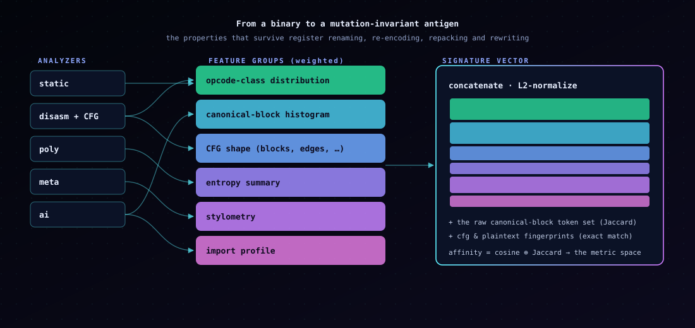
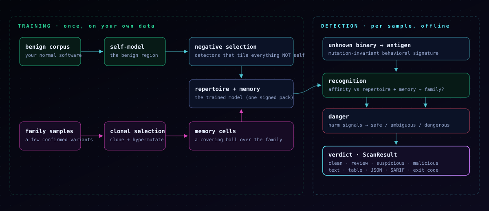
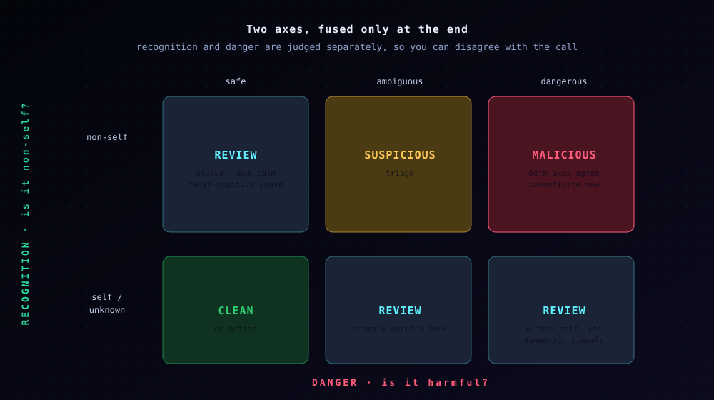

# Concepts: how agat thinks

agat borrows the *computational logic* of the vertebrate immune system to
detect malware variants. This is bio-inspired computing, not a biological
simulation — every mechanism below is a concrete algorithm running over real
behavioral features. Where an analogy is weaker than it looks, we say so.

- [The problem: the surface is no longer a signal](#the-problem-the-surface-is-no-longer-a-signal)
- [The antigen: a mutation-invariant signature](#the-antigen-a-mutation-invariant-signature)
- [Self and non-self: negative selection](#self-and-non-self-negative-selection)
- [Immune memory: clonal selection](#immune-memory-clonal-selection)
- [Danger: not everything foreign is harmful](#danger-not-everything-foreign-is-harmful)
- [Fusing the two axes](#fusing-the-two-axes)
- [Honesty ledger](#honesty-ledger)
- [References](#references)

---

## The problem: the surface is no longer a signal

Every generation of malware attacks one assumption — that a threat looks the
same twice.

- **Polymorphic** code re-encrypts its body with a fresh key and stub each
  copy. File hashes and byte signatures break.
- **Metamorphic** code rewrites itself: registers swapped, junk inserted,
  instructions re-encoded. Stub signatures and naive matching break.
- **AI-rewritten** code goes further — an LLM re-implements the same behavior
  as *different code*, on demand, at scale. Anything keyed to structure,
  including canonical-form hashing, breaks.

Signature engines, YARA, and fuzzy hashes all match the **surface**, and the
surface is now free to change arbitrarily. The immune system faces the same
problem — a pathogen mutates its surface proteins constantly — and solves it
not by memorizing exact shapes but by **graded affinity to an adaptive
repertoire** that learns and generalizes.

---

## The antigen: a mutation-invariant signature

An immune response begins with *antigen presentation*: the distinctive
features of a pathogen are displayed for recognition. agat's antigen is a
behavioral signature built from five analyzers:

| analyzer | contributes |
|---|---|
| static | entropy, strings, imports/exports, section layout |
| disasm | the control-flow graph |
| poly | the recovered-plaintext fingerprint (decrypt, then hash the payload) |
| meta | the canonical control-flow fingerprint (Weisfeiler–Lehman) |
| ai | stylometry and LLM artifacts |

These feed six **weighted feature groups** — opcode-class distribution,
canonical-block histogram, CFG shape, entropy summary, stylometry, and import
profile — which concatenate and L2-normalize into a fixed-dimensional
**signature vector**. Alongside it agat keeps the raw canonical-block token
set (for a Jaccard view) and the CFG/plaintext fingerprints (for exact
matches).

The design property, and the entire reason recognition can generalize, is
that the dominant features are **invariant** to register renaming, operand-
width changes, instruction substitution, and NOP insertion, and only move
under genuine algorithm substitution. Polymorphism and metamorphism rewrite
the surface; the antigen holds still.

Two antigens are compared by **affinity** — a blend of cosine similarity
over the signature and Jaccard over the block tokens, in `[0, 1]`. That
graded metric, not an all-or-nothing hash match, is what lets agat recognize
a variant it has never seen.

---

## Self and non-self: negative selection

A T-cell matures by **negative selection**: cells that react to the body's
own tissue are culled, so the survivors react only to *non-self*. agat does
the same (Forrest et al. 1994; Ji & Dasgupta's real-valued V-detector,
2004):

1. Build a **self-model** — the region of antigen space occupied by your
   benign software.
2. Generate candidate **detectors** at random. Discard any that fall too
   close to self. Keep the rest.
3. The survivors tile the space *outside* self. Any sample a detector binds
   is non-self.

The crucial consequence: **this layer needs no malware to train.** It is a
pure anomaly detector, shaped entirely by what "normal" looks like in your
environment — which is also why self must be trained on software like what
you scan.

---

## Immune memory: clonal selection

Meeting a pathogen once makes the immune system faster the next time, and it
recognizes *relatives* of that pathogen, not just the exact strain. That is
**clonal selection and affinity maturation** (de Castro & Von Zuben's
CLONALG, 2002), and it is how agat learns families.

When you `mature` a confirmed family variant:

1. The detectors that bind it best are **cloned** in proportion to affinity.
2. Each clone is **hypermutated** in inverse proportion to affinity (poor
   binders explore more).
3. The best clone is promoted to a long-lived **memory cell** labelled with
   the family.

A memory cell is not a point — it is a **covering ball** over the family's
confirmed variants. Its center is the running centroid of the variants it has
incorporated, and its radius grows to cover their spread plus a
generalization slack. Over successive variants the ball comes to cover the
family's neighborhood, so a *new* variant that lands inside it triggers a
fast **secondary response**: recognized, attributed to the family, without
its hash ever having existed. That is generalization, not memorization — and
agat measures it (`bench/run.sh`, `bench/generalize.sh`).

---

## Danger: not everything foreign is harmful

Pure self/non-self discrimination has a flaw the immune system itself has:
plenty of foreign things (food, commensal bacteria) are harmless, and
attacking them all is autoimmunity. Matzinger's **danger theory** resolves
it — the immune system responds to *damage signals*, not mere foreignness.

agat's danger layer is a **Dendritic Cell Algorithm** (Greensmith & Aickelin,
2005): it fuses concrete harm signals into a context. Signals come in three
classes:

- **PAMP** (definitive pathogen markers): a decryptor loop whose key agat
  recovered, embedded LLM artifacts.
- **danger** (stress/damage markers): high-entropy regions, a writable+
  executable section, injection-style imports, distance from self.
- **safe** (healthy context): low entropy, a benign import profile, no AI
  artifacts, being inside the self region.

The fused danger score lands in one context: `safe`, `ambiguous`, or
`dangerous` (with `inconclusive` when there is too little signal to judge).
This is the layer that keeps unusual-but-benign software — a new internal
tool, a legitimately packed installer — from being dragged into an alert
just for being unfamiliar.

---

## Fusing the two axes

agat answers two independent questions and fuses them only at the very end:

- **Recognition** — *is it non-self, and whose family?*
- **Danger** — *does it carry harm signals?*

The fused **severity** is advice, not an oracle:

- both agree (non-self **and** dangerous) → **malicious**;
- non-self with ambiguous danger → **suspicious**;
- only one axis fires (unusual-but-calm, or familiar-but-dangerous) →
  **review**;
- neither → **clean**.

Both axes are always present in the result, so a consumer that disagrees with
agat's fusion policy can apply its own.

---

## Honesty ledger

The analogy is a design tool, not a claim of biological fidelity. Where it is
weakest:

- **The Dendritic Cell Algorithm is signal-fusion math, not a running
  dendritic-cell population.** agat applies it per sample, not as a temporal
  process over an antigen stream.
- **Negative selection's coverage is measured, not guaranteed.** How well the
  repertoire covers non-self depends on the benign corpus; agat reports the
  numbers rather than asserting completeness.
- **The affinity metric is engineered.** The feature weights are chosen, not
  learned. `bench/sweep.sh` shows the verdict is stable across a wide range
  of them, pre-empting "you hand-tuned it," but they are still a design
  choice.
- **"Self" is benign-behavior space, not biology.** It is only as good as the
  benign software you train on.

agat never claims to catch everything. It catches **variants that signatures
miss**, as a complement to your signature layer, and it publishes its
coverage limits next to its capabilities.

---

## References

- Forrest, Perelson, Allen & Cherukuri. *Self-Nonself Discrimination in a
  Computer.* IEEE S&P, 1994.
- Ji & Dasgupta. *Real-Valued Negative Selection Algorithm with
  Variable-Sized Detectors.* GECCO, 2004.
- de Castro & Von Zuben. *Learning and Optimization Using the Clonal
  Selection Principle (CLONALG).* IEEE Trans. Evol. Comput., 2002.
- Greensmith, Aickelin & Cayzer. *Introducing Dendritic Cells as a Novel
  Immune-Inspired Algorithm for Anomaly Detection.* ICARIS, 2005.
- Matzinger. *The Danger Model: A Renewed Sense of Self.* Science, 2002.
