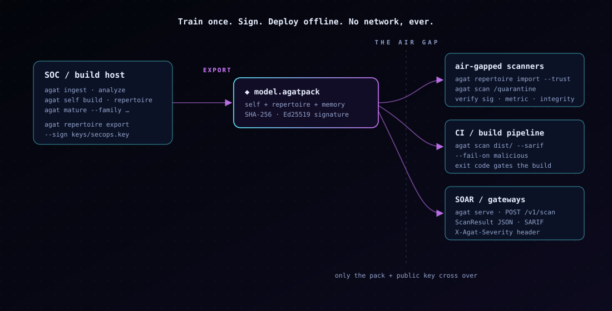

# Deployment & operations

How to run agat in production: where it fits, how to train and distribute a
model across a fleet, container and air-gap operations, and performance.



- [Where agat fits](#where-agat-fits)
- [Reference topology](#reference-topology)
- [Building and pinning a model](#building-and-pinning-a-model)
- [Distributing to a fleet](#distributing-to-a-fleet)
- [Containers and the air gap](#containers-and-the-air-gap)
- [Performance and sizing](#performance-and-sizing)
- [Key management](#key-management)
- [Upgrades and compatibility](#upgrades-and-compatibility)
- [Hardening](#hardening)

---

## Where agat fits

agat is a **variant-catching layer**, not an antivirus replacement. Put it
where binaries enter your world and run it *after* your signature layer:

| layer | catches | misses |
|---|---|---|
| signature AV / YARA | exact known threats, fast | anything re-encrypted, re-compiled, or rewritten |
| EDR | malicious *runtime* behavior | threats that never execute on a monitored host; offline artifacts |
| **agat** | **new variants of known families**, foreign binaries carrying harm signals — pre-execution, offline | threats that look benign *and* carry no harm signals; architectures it does not analyze yet |

Good insertion points: build outputs and artifact registries, quarantine
folders, email-gateway detonation drops, golden-image validation, and
air-gapped transfer stations.

---

## Reference topology

One **model-building host** (in your SOC or a trusted build environment) owns
the training data and the signing key. It produces a signed model pack. That
pack — and only that pack plus the public key — is distributed to any number
of **scanning hosts**, which never need training data, a password, or a
network.

```
  model-building host  ──sign──▶  model.agatpack  ──▶  scanning hosts (N)
   (vault + signing key)          (one file)            (import --trust, scan)
```

This keeps the sensitive assets (raw samples, the signing key) in one place
and lets the scanning fleet be stateless and disposable.

---

## Building and pinning a model

On the model-building host:

```bash
export AGAT_VAULT_PASSWORD='…'
agat ingest ./benign/* ./families/*/*
agat analyze
agat self build $(agat list | awk '/benign/{print $1}')
agat repertoire generate --seed 1
for v in $(agat list | awk '/qakbot/{print $1}'); do
  agat mature "$v" --family qakbot
done
agat repertoire info                 # review before shipping
```

**Validate before you ship.** Measure the model on a held-out labeled corpus
so you know its detection and false-positive rates:

```bash
bench/evaluate.sh --corpus /data/labeled --labels /data/labels.tsv \
  --min-detect 0.9 --max-fp 0.0
```

Record the model version and the evaluation numbers alongside the pack; the
pack's manifest (`agat repertoire info` after import) carries the name,
version, families, and antigen fingerprint.

---

## Distributing to a fleet

Export once, signed:

```bash
agat repertoire export qakbot-2026.10.agatpack \
  --name acme-threats --version 2026.10 \
  --description "qakbot + emotet; golden-image self" \
  --sign keys/secops.key
```

On each scanning host, establish trust once (ship `secops.pub` out of band —
e.g. baked into the image, or in `/etc/agat/trusted_keys/`), then import:

```bash
agat repertoire import qakbot-2026.10.agatpack --trust /etc/agat/secops.pub
```

Import **refuses** a pack that is unsigned (unless `--allow-unsigned`),
signed by an untrusted key, tampered with (SHA-256/signature), or trained in
a different antigen metric space (an incompatible agat version). Use
`--dry-run` to inspect a pack's manifest without installing it.

Rolling out an update is just distributing a new pack and re-importing; the
new model replaces the old one atomically. Keep previous packs to roll back.

---

## Containers and the air gap

The container is a `scratch` image holding only the static binary (≈12 MB).
It has no shell and no package manager.

```bash
# scan a read-only mount with no network at all
docker run --rm --network none \
  -v "$HOME/.agat:/data" -v "$PWD:/scan:ro" \
  agat scan /scan --output table

# run the HTTP API, published on the host loopback only
docker run --rm -p 127.0.0.1:8080:8080 \
  -v "$HOME/.agat:/data" \
  agat serve --listen 0.0.0.0:8080 --allow-remote
```

agat makes no outbound connection. **Prove it rather than trust it:** run
under `--network none`, as above. The project's own demo does this and diffs
the output against a laptop run (`demo/run.sh --compare`) to show they are
byte-identical.

For an air-gapped scanning host, the agat home (`/data`) is populated by
importing a pack — nothing else needs to cross the gap.

---

## Performance and sizing

- Scanning is CPU-bound and **parallel**: `agat scan` uses all cores by
  default (`-j N` to cap). On an 18-core laptop, ~900 typical binaries scan
  in about 2 seconds.
- No GPU, no model download, no network latency — throughput is just cores ×
  per-file analysis time, which is dominated by disassembly of large `.text`
  sections.
- Memory is bounded per file; stateless scans hold no cross-file state, so a
  worker's footprint is roughly the largest file it analyzes.
- The model (self-model + repertoire + memory) loads once per process and is
  shared read-only across workers.

For high-volume pipelines, prefer `agat serve` (model loaded once, many
requests) over launching the binary per file.

---

## Key management

- The signing key (`*.key`) is an Ed25519 secret. `agat key generate` writes
  it mode `0600`; treat it like any code-signing key — store it in your
  secrets manager or an HSM-backed environment, not on scanning hosts.
- The public key (`*.pub`) is distributed to scanning hosts and is safe to
  ship in images or configs.
- Rotating the signing key means generating a new keypair, re-exporting the
  model with it, and distributing the new public key before the new pack.
- Trust is explicit: a scanning host accepts a pack only if its signer is in
  `--trust`, `[packs] trusted_keys`, or `~/.agat/trusted_keys/`.

---

## Upgrades and compatibility

- The JSON result is versioned (`schema_version: "agat.scan/v1"`). Gate
  consumers on it; a breaking change bumps the suffix.
- The antigen metric is versioned internally. When an agat upgrade changes
  how features are built, the antigen fingerprint changes and **old packs are
  refused at import** rather than silently mis-scored — so you retrain and
  re-ship, and never get wrong answers from a stale model.
- Pin the agat version on the model-building host and the scanning fleet
  together, and upgrade them as a unit.

---

## Hardening

- Run `agat scan` as an unprivileged user; it needs only read access to the
  files and the agat home. The container runs as nobody by default.
- Mount scanned content read-only (`-v …:ro`).
- `agat serve` has no authentication — bind it to loopback (the default) and
  front it with an authenticating reverse proxy for anything wider.
- agat parses hostile input; parser crashes are treated as security bugs (see
  `SECURITY.md`). The analyzer crates contain no panics in production code,
  enforced by a fuzz test, but defense in depth — a sandboxed scanning host —
  is still prudent for untrusted files.
